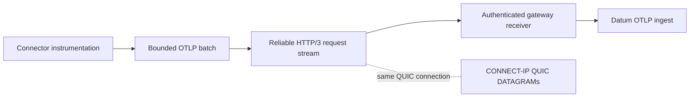

# In-Band Connector Observability

Connect can forward Connector operational telemetry to Datum on reliable
HTTP/3 request streams within the authenticated QUIC connection already used
for CONNECT-IP. IP packets remain in QUIC DATAGRAM frames. Telemetry never uses
the packet datagrams or the CONNECT request stream.

## Product Contract

This feature is opt-in and disabled by default. It requires both:

1. project-side approval in `ConnectNetworkBinding.spec.telemetry`; and
2. local Connector consent through `DATUM_CONNECT_IN_BAND_TELEMETRY=true`.

Capability negotiation does not constitute consent. Removing either approval
stops new export. The first implementation carries curated Connect health
metrics. The transport also supports trace batches, but the product does not
forward arbitrary logs, application telemetry, packet contents, credentials,
command arguments, or unrestricted attributes.

Telemetry is best effort and subordinate to packet forwarding. Export failure,
rejection, congestion, or collector unavailability cannot close CONNECT-IP.

## Data Path



The client asks for telemetry capability on CONNECT-IP setup only when local
consent is active. The gateway intersects that request with the binding grant
and advertises the approved signals in its successful response. Each OTLP
protobuf batch uses a separate bidirectional HTTP/3 request:

```text
POST /v1/traces
POST /v1/metrics
Content-Type: application/x-protobuf
```

Requests and responses are capped at 256 KiB. The client serializes requests
through one connection-scoped sender. The gateway uses a bounded request queue
and returns `403`, `413`, `429`, or `503` without affecting CONNECT-IP when a
request is unauthorized, oversized, over capacity, or cannot be forwarded.

## Identity and Tenancy

The QUIC endpoint key authenticates the Connector; the telemetry channel adds
no bearer credential. A request is accepted only after CONNECT-IP admission on
the same connection. Controller-rendered grants carry canonical project,
Connector, binding, and gateway identifiers. The gateway forwards those values
as trusted ingestion headers rather than trusting tenant attributes in the OTLP
payload. Platform ingestion must replace conflicting resource attributes before
storage.

Gateway grants are strict JSON. A telemetry grant must enable at least one
signal and contain bounded non-empty canonical identifiers. Bindings that omit
`spec.telemetry` render no telemetry policy and cannot negotiate export.

## Runtime Configuration

Connector local consent:

```text
DATUM_CONNECT_IN_BAND_TELEMETRY=true
```

Gateway platform ingestion target:

```text
DATUM_CONNECT_IN_BAND_OTLP_ENDPOINT=https://collector.example
```

The gateway appends `/v1/traces` or `/v1/metrics`. If the endpoint is absent,
the packet service still starts and telemetry requests receive `503`.

The Connector status includes requested, active, trace, and metric telemetry
state. Health metrics are emitted every ten seconds only when both sides approve
metrics. Each upload has a three-second deadline and runs outside the packet
forwarding loop.

## Current Boundaries

- Delivery uses bounded memory and has no disk spool or delivery guarantee.
- Local logs and status remain necessary for failures before authentication or
  while disconnected.
- Gateway self-observability continues on its independent OTLP path.
- Both streams and datagrams share QUIC congestion control. Production rollout
  requires constrained-bandwidth and relay-path tests demonstrating acceptable
  packet latency and loss.
- Arbitrary logs and application telemetry require a separate product, privacy,
  retention, and capacity decision.

## Related Documentation

- [Observability](./observability.md)
- [CONNECT-IP Data Plane](./connect-ip-data-plane.md)
- [Identity and Authorization](./identity-and-authorization.md)
- [Multi-Tenancy](./multi-tenancy.md)
