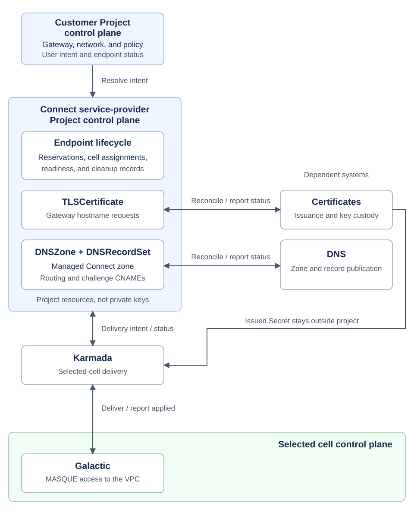

# Managed gateway hostnames and certificates

[Documentation overview](../../README.md) · [Acceptance tests](acceptance-tests.md) · [Source review](source-review.md)

## Summary

Give each logical `ConnectGateway` one stable hostname per metro and a publicly
trusted certificate for each hostname. Existing Galactic MASQUE infrastructure
serves these endpoints. Creating a gateway does not create a Workload or a
separate provider deployment.

Connect owns endpoint provisioning in a dedicated service-provider Project
control plane and coordinates DNS, certificate issuance, and cell registration. Galactic owns per-stream admission and the packet paths into the selected VPCs.
The certificate service owns issuance and renewal; infra supplies the deployment
and distribution wiring.

This is the design for the draft implementation in Connect PR #74 and its
Galactic, Certificates and Infrastructure dependencies. No live deployment is
claimed. The [source review](source-review.md) separates tested code from release
gates. This documentation branch remains based on main; the implementation
retains the required gateway prototype base.

## Motivation

Users name a gateway, its metros, and the networks they want to attach. They should
not need to manage DNS records, upload certificates, or deploy gateway processes.
A hostname should remain stable when provider pods change or certificates renew.

The first version uses platform-managed names and one active serving cell per
metro endpoint. Customer domains, wildcard certificates, and transparent roaming
between cells are outside this proposal.

## Proposal

### Architecture and ownership

The **customer Project control plane** holds the user's gateway, connection
policy, and bindings. It exposes endpoint status to the customer.

The **Connect service-provider Project control plane** holds Connect's internal
resources: endpoint assignments, hostname reservations, `TLSCertificate` requests,
the managed `DNSZone` and its `DNSRecordSet` resources, desired cell registrations,
and distribution progress.
It also holds readiness, pending operations, and cleanup records. Connect resolves
customer Locations into metros and keeps one endpoint per gateway and metro;
several Locations in one metro share that endpoint.

This service project is the durable home for Connect's lifecycle state. `ConnectEndpoint` owns the durable reservation and selected cell;
`ConnectGrant` pins each binding to resolved Network and VPC identities. Customer
placements reference the shared endpoint. DNS and certificate requests use the
existing project APIs. Records
retain the customer project and gateway UIDs so cleanup can continue after the
customer project disappears. Customer credentials cannot modify them. The service
project must remain available until its endpoints and cleanup work are released.

**DNS and Certificates** reconcile resources in the service-provider project.
Their controllers and serving infrastructure run outside that project. DNS
publishes the zone and records; Certificates reconciles `TLSCertificate` requests
and reports issuance status. Creating these resources in the project does not mean
running the dependent systems there.

Certificates keeps its underlying issuance resources and private keys in its own
infrastructure. Karmada holds downstream distribution resources and delivers the
issued Secret to the selected cell. The project holds desired state and status,
not a copy of the certificate's private key.

The **cell control plane** is separate. It holds the delivered TLS Secrets,
Galactic endpoint registrations, and runtime networking resources. Karmada delivers
configuration to the selected cell and returns status. Galactic reports when the
configuration is applied; delivery alone does not make an endpoint ready.

### Customer APIs and shared transport

A managed `ConnectGateway` selects placement, not one Network. A
`ConnectNetworkBinding` names `gatewayRef`, `connectorRef` and `networkRef`.
`ConnectConnectionPolicy.networkRefs` explicitly lists the allowed networks in
addition to its gateway and connector scope. An existing policy with no network
list grants no managed access; migration is explicit, never an implicit wildcard.
Legacy single-network gateways retain their separate `legacy-v1` contract.

The client pools one HTTP/3 QUIC or HTTP/2 TLS/TCP connection per gateway endpoint
and client security context. Each binding opens its own authenticated CONNECT-IP
stream with an independently issued credential and network plan. A shared TLS
connection is not shared authorization. The provider checks endpoint, grant,
VPC selector and live VPC UID on every request and refresh.

Users never provide UIDs, cell IDs or VPC identifiers. The broker resolves names
and sends internal routing selectors only in the sensitive protocol descriptor.
Per-binding grants retain separate routes, revocation and VPC/cell `/96` ledgers.
Stream cancellation and credential refresh leave sibling streams running. After
a transport failure, each desired attachment reauthorizes and reconnects through
the same context-specific pool. Device-local overlapping routes remain rejected;
server stream isolation is not a device network-routing context.

### Stable names

Reserve the hostname in the service project against the customer project UID,
gateway UID, and metro ID. Keep it
through temporary capacity failures and pod replacements. A gateway recreated
under the same resource name receives a new hostname.

Keep the platform-owned Connect `DNSZone` in the service-provider project and
allocate an opaque random hostname label, independent of resource UIDs. Provision the zone and its parent delegation
once; individual gateway endpoints share it. The domain is operator-configured; each label is random and stored once.
Resource UIDs are internal recreation fences, not user inputs or public labels. Reserve names with a uniqueness check that works
across controller replicas. Retries must continue the same reservation rather
than allocate another name.

## Design details

### Provisioning flow

1. **Resolve the request.** Check project permissions and metro membership.
   The gateway is independent of any network. Select existing Galactic capacity in one cell and save the endpoint
   record in the service-provider project before changing other control planes.
2. **Request the certificate.** Create a `TLSCertificate` in the service-provider
   project for Certificates to reconcile, with explicit
   `issuance: DNS01`. Its `Auto` mode chooses HTTP-01 for non-wildcard names, which
   would introduce an unnecessary HTTP challenge listener.
3. **Publish validation DNS.** Read the exact CNAME from
   `TLSCertificate.status.requiredDNSRecords` and create a `DNSRecordSet` in the
   same service-provider project, referencing its managed zone. DNS publishes it.
   The certificate service manages the validation TXT record at the delegated
   target and completes issuance through central cert-manager.
4. **Deliver and apply.** Validate the issued key pair and send it with the endpoint
   registration to the selected cell. Wait for Galactic to report the applied
   endpoint and certificate versions.
5. **Publish routing DNS.** Create or update the service project's routing
   `DNSRecordSet` to point at the selected cell's public frontend. Verify TLS and the advertised transports from outside the cell, and
   validate DNS convergence. Per-network packet checks are separate from endpoint
   readiness.
6. **Enable client connections.** Mark the endpoint ready and allow the credential
   broker to return it to authorized connectors.

The challenge CNAME and traffic-routing record have different jobs. Keep the
challenge CNAME for renewal. Neither record grants access to the VPC.

### Certificate issuance and delivery

The certificate service rejects protected platform domains unless its managed
issuance path verifies a live reservation in the pinned service project and the
exact authenticated Connect writer. Both reservation lifecycle and phase must
be Active, and `status.certificateRef` must match the request name and UID. Ordinary project requests must
not gain permission to issue for the entire Connect domain. Requests belong in
the Connect service-provider project; requests carry `managedAuthorization:{reservationName,reservationUID}`. Hosting
the request there does not itself bypass protected-domain validation.

Reuse the service's stored-certificate contract. Wait for `TLSCertificate`
readiness, derive the Secret name with `StoredSecretName(uid)`, and check its
upstream UID label. Validate the certificate's name, validity, and matching key
before delivery. Use the stored Secret, not the temporary issuance Secret.

Private keys remain in Certificates infrastructure and the selected serving cell.
They never enter either Project control plane or connection descriptors. Cells receive the
resulting Secret, not ACME accounts, issuance resources, or DNS-writing credentials.
The private CA used between Galactic providers and their grant authority remains
separate from the public endpoint certificate.

Certificate delivery needs an explicit version. Expiry alone is insufficient:
an emergency replacement can expire sooner or have the same expiry. Watch the
stored Secret and certificate status, reject obsolete delivery attempts, and
track which certificate each serving instance has applied.

### Galactic listener integration

`MASQUEEndpoint` associates each hostname with its certificate and gateway
identity, not a Network or VPC. It retains one cell, provider, monotonic endpoint
revision and leaf-DER SHA256 certificate revision. Per-instance applied status
must match both revisions. Private keys live only in cell Secrets and the central
Certificates infrastructure.

The listener must select the certificate by TLS SNI and check the HTTP authority
on every CONNECT request, for both HTTP/3 and HTTP/2. The requested hostname and
the credential's grant must authorize the same endpoint scope. A valid certificate
or a valid grant for another gateway is not sufficient.

Apply registration updates atomically and acknowledge their versions. Unknown or
disabled hostnames must be rejected. A bad certificate or registration for one
gateway must not interrupt other gateways sharing the listener.

### Client connections and cell selection

The broker checks the current binding and policy, selects a ready endpoint, and
obtains a grant from Galactic for its actual serving cell. The existing descriptor
carries the hostname, credential, expiry, VPC selector, transports, and network
plan. The client verifies WebPKI and checks the granted prefix and routes before
activating its interface.

Galactic serves HTTP/3 over UDP/443 and HTTP/2 over TCP/443. Clients may fall back
to HTTP/2 for an HTTP/3 connectivity failure, not for a TLS or authorization error.

Grants and retained `/96` allocations are cell-scoped. DNS must therefore send an
endpoint's traffic to its selected cell, not randomly spread it across cells.
The selected cell must support every attached VPC. Operator capacity selects a
metro/cell/provider/frontend; a separate reachability map pins each Network UID
and selected cell to its VPC UID. An unsupported binding stays unready without
moving the endpoint. This design does not add cross-cell forwarding or roaming.

### Readiness and recovery

An endpoint is ready only when its current configuration is authorized, its
certificate is valid and applied, DNS points to the selected frontend, and fresh
external checks pass for DNS, TLS and both transports. These checks do not
establish access to every network. Each binding separately needs explicit policy,
current Network/VPC identity and selected-cell reachability. Real packet checks
remain a per-binding release gate. A ready pod or Secret delivery is insufficient.

Project status should explain whether the endpoint is waiting on a certificate,
DNS or listener configuration. Binding status separately explains network access. It may show the hostname, metro,
and validity dates. Keep private references and credentials out of that status.

Controllers save object UIDs, desired versions, and pending work so they can
resume after a restart or a lost response. Old workers must not overwrite a newer
registration or restore a deleted endpoint. An unavailable project API is not
evidence that the project was deleted.

### Renewal, revocation, and deletion

The certificate service renews centrally. Deliver the new Secret, let Galactic
reload it, and verify the applied version before retiring the old copy. A failed
renewal should raise an alert while a valid certificate continues serving. Stop
advertising an endpoint before its serving certificate expires.

Deleting or recreating a Network revokes only its affected bindings. Recreate the
binding to approve a replacement identity; old grants never bind to a same-name
replacement. Shared DNS, certificate and listener resources remain intact.
Revoking one binding closes only its streams. Disabling the endpoint drains all
of its streams. Revoking access must disable affected grants through Galactic;
changing DNS does not stop existing connections. A certificate compromise also
requires replacing or disabling the key and defining how existing sessions end.

When the gateway is deleted or its last desired placement leaves a metro:

1. Stop issuing descriptors and disable the endpoint's admission and grants.
2. Verify forwarding has stopped, withdraw routing DNS, and allow for cached DNS.
3. Remove registrations and delivered keys from every recorded target cell.
4. Delete the issuance request, verify certificate cleanup, and remove the owned
   challenge CNAME record. Preserve the shared `DNSZone` and other endpoints'
   records. Leave certificate-service delegation anchors to their owner.
5. Finish release only after cleanup is confirmed. Retain a hostname tombstone so
   another gateway cannot acquire it.

A temporary placement failure does not release the hostname. Removing one of
several same-metro placements does not delete their shared endpoint. The same
live gateway may reactivate a removed metro under a new configuration version;
a deleted gateway's name stays retired. Galactic retains ownership of allocation
tombstones and shared serving infrastructure throughout cleanup.

### Remaining release decisions

Supply qualified image/OCI digests, credential frontend routing, the trusted
external probe, quotas and permanent-cell-loss recovery. Validate the whole
DNS/ACME/Karmada/cell path before enabling the suspended deployment wrappers.

## Production readiness

Start with one gateway in one metro, then add another tenant on the same listener
and a second metro. The [acceptance tests](acceptance-tests.md) cover isolation,
renewal, controller restarts, cell failures, and cleanup. These are proposed tests,
not evidence of a working deployment.

Before rollout, agree on probe freshness, certificate expiry margins, revocation
and drain deadlines, quotas, and recovery for a permanently lost cell. Monitor
issuance failures, certificate lifetime, unapplied versions, failed probes, and
blocked cleanup. Keep credentials out of logs.

Enable the feature gradually. Disabling provisioning must leave existing renewal
and cleanup running. A rollback to a single-authority listener requires draining
multi-host endpoints or preserving a compatible serving version.

## Alternatives and tradeoffs

Per-host certificates add issuance and distribution load, but limit key sharing.
A wildcard reduces that load at the cost of a broader compromise scope.

Restricted central cert-manager `Certificate` resources could provide an initial
issuance path. That would require Connect to define more of the authorization,
Secret-consumption, and cleanup contract itself. Prefer extending the existing
certificate service where practical.

DNS aliases alone do not supply hostname admission or certificate selection.
Dedicated gateway deployments would add a compute lifecycle that this design does
not need. Issuing in every cell would duplicate ACME state and credentials.

## Infrastructure needed

Provision the Connect service-provider project and scoped service identities.
Reuse DNS, Certificates, Karmada, and existing Galactic MASQUE capacity. Add
managed-domain issuance, endpoint registration, certificate delivery, and probes.
Connect owns the end-to-end contract; each service owns its implementation.

## Implementation history

2026-11-18: proposed the lifecycle and reviewed source capabilities. Simplified the
design and added SVG diagrams in the style of Fleet's machine-lifecycle enhancement.
No runtime implementation, deployment, or live validation accompanies this document.

2026-11-19: chose a Connect service-provider Project control plane for internal
lifecycle resources and separated it from customer projects and cell runtime state.

The service-provider project also owns DNS zone/record resources and certificate
requests; DNS and Certificates reconcile them from outside the project.

2026-11-20: revised gateways to be VPC-independent, with one pooled transport and
independent authenticated streams. Named binding/policy network scope is explicit.
Implementation and test evidence are tracked separately from live qualification.
