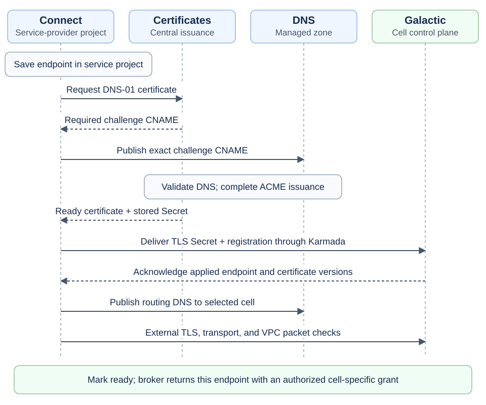

# Managed gateway hostnames and certificates

[Documentation overview](../../README.md) · [Acceptance tests](acceptance-tests.md) · [Source review](source-review.md)

## Summary

Give each logical `ConnectGateway` one stable hostname per metro and a publicly
trusted certificate for each hostname. Existing Galactic MASQUE infrastructure
serves these endpoints. Creating a gateway does not create a Workload or a
separate provider deployment.

Connect coordinates DNS, certificate issuance, and endpoint registration across
control planes. Galactic owns tunnel admission and the packet path into the VPC.
The certificate service owns issuance and renewal; infra supplies the deployment
and distribution wiring.

This is a proposal. The existing components provide much of the foundation, but
managed-domain issuance and shared-listener registration still need work. The
[source review](source-review.md) separates existing capabilities from proposals.

## Motivation

Users should select a network and the metros where they want access. They should
not need to manage DNS records, upload certificates, or deploy gateway processes.
A hostname should remain stable when provider pods change or certificates renew.

The first version uses platform-managed names and one active serving cell per
metro endpoint. Customer domains, wildcard certificates, and transparent roaming
between cells are outside this proposal.

## Proposal

### Architecture and ownership

The project control plane holds the user's gateway, connection policy, and
bindings. Connect resolves the selected Locations into metros and keeps a
service-owned endpoint record for each gateway and metro. Several Locations in
one metro share that endpoint.

The endpoint record tracks the reserved name, network, selected cell, certificate,
DNS records, and progress. It also retains enough information to finish cleanup
if the project disappears. Its exact API representation remains open: it could
be an internal resource referenced by existing placements.

The certificate service issues centrally. Karmada delivers the resulting TLS
Secret and endpoint registration only to the selected serving cell. Galactic
reports when its listeners have applied them. The cell control plane is a separate
boundary; Karmada delivers configuration across that boundary and receives status
back. Delivery alone does not establish
that an endpoint is ready.

### Stable names

Reserve the hostname against the project UID, gateway UID, and metro ID. Keep it
through temporary capacity failures and pod replacements. A gateway recreated
under the same resource name receives a new hostname.

Use a platform-owned zone and an opaque gateway identifier. The domain and label
format are still to be chosen. Reserve names with a uniqueness check that works
across controller replicas. Retries must continue the same reservation rather
than allocate another name.

## Design details

### Provisioning flow

1. **Resolve the request.** Check project permissions, network identity, and metro
   membership. Select existing Galactic capacity in one cell and save the endpoint
   record before making changes in other control planes.
2. **Request the certificate.** Use the existing certificate service with explicit
   `issuance: DNS01`. Its `Auto` mode chooses HTTP-01 for non-wildcard names, which
   would introduce an unnecessary HTTP challenge listener.
3. **Publish validation DNS.** Read the exact CNAME from
   `TLSCertificate.status.requiredDNSRecords` and create it through `DNSRecordSet`.
   The certificate service manages the validation TXT record at the delegated
   target and completes issuance through central cert-manager.
4. **Deliver and apply.** Validate the issued key pair and send it with the endpoint
   registration to the selected cell. Wait for Galactic to report the applied
   endpoint and certificate versions.
5. **Publish routing DNS.** Point the hostname at the selected cell's public
   frontend. Verify TLS and the advertised transports from outside the cell, and
   test a VPC packet exchange with a restricted test identity.
6. **Enable client connections.** Mark the endpoint ready and allow the credential
   broker to return it to authorized connectors.

The challenge CNAME and traffic-routing record have different jobs. Keep the
challenge CNAME for renewal. Neither record grants access to the VPC.

### Certificate issuance and delivery

The certificate service currently rejects protected platform domains. Before
using it for Connect names, add an internal issuance path that checks the reserved
hostname and the requesting service's authority. Ordinary project requests must
not gain permission to issue for the entire Connect domain. The location and API
of this internal request remain open.

Reuse the service's stored-certificate contract. Wait for `TLSCertificate`
readiness, derive the Secret name with `StoredSecretName(uid)`, and check its
upstream UID label. Validate the certificate's name, validity, and matching key
before delivery. Use the stored Secret, not the temporary issuance Secret.

Private keys remain in service infrastructure and the selected serving cell.
They never enter project status or connection descriptors. Cells receive the
resulting Secret, not ACME accounts, issuance resources, or DNS-writing credentials.
The private CA used between Galactic providers and their grant authority remains
separate from the public endpoint certificate.

Certificate delivery needs an explicit version. Expiry alone is insufficient:
an emergency replacement can expire sooner or have the same expiry. Watch the
stored Secret and certificate status, reject obsolete delivery attempts, and
track which certificate each serving instance has applied.

### Galactic listener integration

Galactic currently accepts one configured authority per provider process and can
reload certificate files. Shared gateway endpoints require a registration contract
that associates each hostname with its certificate and allowed gateway/network.

The listener must select the certificate by TLS SNI and check the HTTP authority
on every CONNECT request, for both HTTP/3 and HTTP/2. The requested hostname and
the credential's grant must authorize the same endpoint scope. A valid certificate
or a valid grant for another gateway is not sufficient.

Apply registration updates atomically and acknowledge their versions. Unknown or
disabled hostnames must be rejected. A bad certificate or registration for one
gateway must not interrupt other gateways sharing the listener.

### Client connections and cell selection

The broker checks the current binding and policy, selects a ready endpoint, and
obtains a grant from Galactic for its actual serving cell. The existing descriptor
carries the hostname, credential, expiry, VPC selector, transports, and network
plan. The client verifies WebPKI and checks the granted prefix and routes before
activating its interface.

Galactic serves HTTP/3 over UDP/443 and HTTP/2 over TCP/443. Clients may fall back
to HTTP/2 for an HTTP/3 connectivity failure, not for a TLS or authorization error.

Grants and retained `/96` allocations are cell-scoped. DNS must therefore send an
endpoint's traffic to its selected cell, not randomly spread it across cells.
A cell change requires coordinated routing, new credentials, and a new attachment;
this proposal makes no address-preservation or seamless failover guarantee.

### Readiness and recovery

An endpoint is ready only when its current configuration is authorized, its
certificate is valid and applied, DNS points to the selected frontend, and fresh
external checks pass. Check both advertised transports and a real VPC packet path.
A ready pod or a successful Secret delivery is insufficient.

Project status should explain whether the endpoint is waiting on a certificate,
DNS, listener configuration, or network access. It may show the hostname, metro,
and validity dates. Keep private references and credentials out of that status.

Controllers save object UIDs, desired versions, and pending work so they can
resume after a restart or a lost response. Old workers must not overwrite a newer
registration or restore a deleted endpoint. An unavailable project API is not
evidence that the project was deleted.

### Renewal, revocation, and deletion

The certificate service renews centrally. Deliver the new Secret, let Galactic
reload it, and verify the applied version before retiring the old copy. A failed
renewal should raise an alert while a valid certificate continues serving. Stop
advertising an endpoint before its serving certificate expires.

Revoking access must disable affected grants and sessions through Galactic;
changing DNS does not stop existing connections. A certificate compromise also
requires replacing or disabling the key and defining how existing sessions end.

When the gateway is deleted or its last desired placement leaves a metro:

1. Stop issuing descriptors and disable the endpoint's admission and grants.
2. Verify forwarding has stopped, withdraw routing DNS, and allow for cached DNS.
3. Remove registrations and delivered keys from every recorded target cell.
4. Delete the issuance request, verify certificate cleanup, and remove the owned
   challenge CNAME. Leave certificate-service delegation anchors to their owner.
5. Finish release only after cleanup is confirmed. Retain a hostname tombstone so
   another gateway cannot acquire it.

A temporary placement failure does not release the hostname. Removing one of
several same-metro placements does not delete their shared endpoint. The same
live gateway may reactivate a removed metro under a new configuration version;
a deleted gateway's name stays retired. Galactic retains ownership of allocation
tombstones and shared serving infrastructure throughout cleanup.

### Open decisions

- **Connect:** choose endpoint storage, metro metadata, hostname format, and how
  placements reference their shared endpoint.
- **Certificates:** define managed-domain authorization and reliable replacement
  notifications, including emergency rekeys.
- **Galactic:** define registration, gateway-scoped admission, session revocation,
  and reports of applied configuration.
- **Infra and service owners:** define selected-cell delivery, public exposure,
  removal acknowledgments, and operational limits.

## Production readiness

Start with one gateway in one metro, then add another tenant on the same listener
and a second metro. The [acceptance tests](acceptance-tests.md) cover isolation,
renewal, controller restarts, cell failures, and cleanup. These are proposed tests,
not evidence of a working deployment.

Before rollout, agree on probe freshness, certificate expiry margins, revocation
and drain deadlines, quotas, and recovery for a permanently lost cell. Monitor
issuance failures, certificate lifetime, unapplied versions, failed probes, and
blocked cleanup. Keep credentials out of logs.

Enable the feature gradually. Disabling provisioning must leave existing renewal
and cleanup running. A rollback to a single-authority listener requires draining
multi-host endpoints or preserving a compatible serving version.

## Alternatives and tradeoffs

Per-host certificates add issuance and distribution load, but limit key sharing.
A wildcard reduces that load at the cost of a broader compromise scope.

Restricted central cert-manager `Certificate` resources could provide an initial
issuance path. That would require Connect to define more of the authorization,
Secret-consumption, and cleanup contract itself. Prefer extending the existing
certificate service where practical.

DNS aliases alone do not supply hostname admission or certificate selection.
Dedicated gateway deployments would add a compute lifecycle that this design does
not need. Issuing in every cell would duplicate ACME state and credentials.

## Infrastructure needed

Reuse DNS, Certificates, Karmada, and existing Galactic MASQUE capacity. Add scoped service permissions,
managed-domain issuance, endpoint registration, certificate delivery, and probes.
Connect owns the end-to-end contract; each service owns its implementation.

## Implementation history

2026-11-18: proposed the lifecycle and reviewed source capabilities. Simplified the
design and added SVG diagrams in the style of Fleet's machine-lifecycle enhancement.
No runtime implementation, deployment, or live validation accompanies this document.
